# Audit evidence

Every check on the audit sheet that can be proven with a command, recorded from one clean run of this repository. Each screenshot is rendered from the real terminal output, and the plain transcript sits underneath it.

- **Code:** commit `efbf023` on `main`
- **Started from:** `docker-compose down -v`, then a fresh clone with `.env` copied in
- **Docker:** Engine 29.5.2 and Compose 5.6.0, in a Colima VM on macOS (arm64)
- **Recorded:** 18 October 2026

The run happens in sheet order, so later screenshots depend on earlier ones: the movie posted in 13 is the one listed in 14, and the order stopped in 16 is the one stored in 18. The oral questions (containers, microservices, Dockerfiles, volumes, networks, images) are answered in the [README's Concepts section](README.md#concepts).


## General

### Are all the required files present?

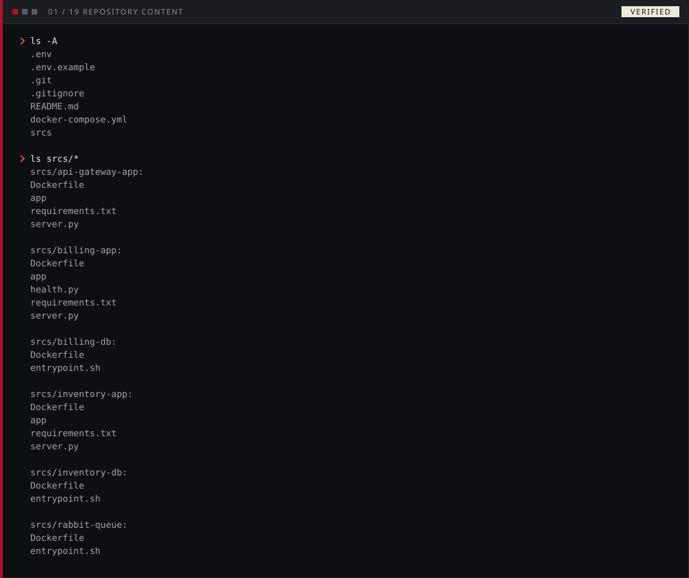

<details><summary>Transcript</summary>

```console
$ ls -A
.env
.env.example
.git
.gitignore
README.md
docker-compose.yml
srcs

$ ls srcs/*
srcs/api-gateway-app:
Dockerfile
app
requirements.txt
server.py

srcs/billing-app:
Dockerfile
app
health.py
requirements.txt
server.py

srcs/billing-db:
Dockerfile
entrypoint.sh

srcs/inventory-app:
Dockerfile
app
requirements.txt
server.py

srcs/inventory-db:
Dockerfile
entrypoint.sh

srcs/rabbit-queue:
Dockerfile
entrypoint.sh
```

</details>

### Was the `.env` file excluded from the git files?

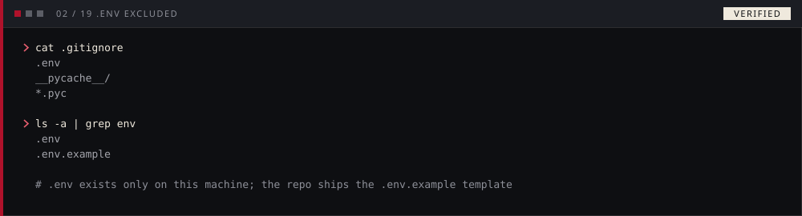

<details><summary>Transcript</summary>

```console
$ cat .gitignore
.env
__pycache__/
*.pyc

$ ls -a | grep env
.env
.env.example

# .env exists only on this machine; the repo ships the .env.example template
```

</details>

### Are all pushed files in the repo clean of any credentials or passwords?

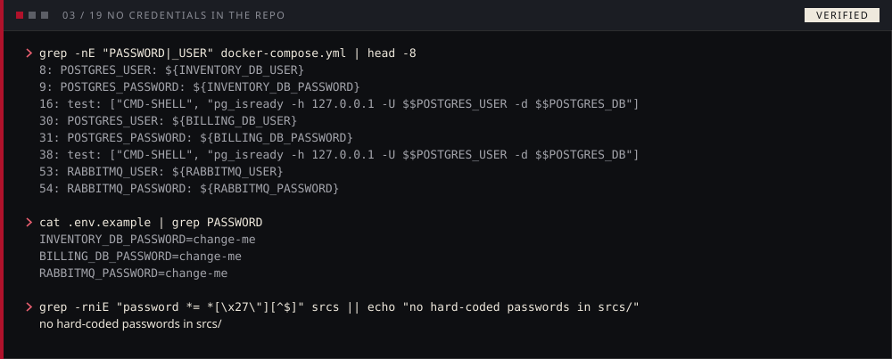

<details><summary>Transcript</summary>

```console
$ grep -nE "PASSWORD|_USER" docker-compose.yml | head -8
8:      POSTGRES_USER: ${INVENTORY_DB_USER}
9:      POSTGRES_PASSWORD: ${INVENTORY_DB_PASSWORD}
16:      test: ["CMD-SHELL", "pg_isready -h 127.0.0.1 -U $$POSTGRES_USER -d $$POSTGRES_DB"]
30:      POSTGRES_USER: ${BILLING_DB_USER}
31:      POSTGRES_PASSWORD: ${BILLING_DB_PASSWORD}
38:      test: ["CMD-SHELL", "pg_isready -h 127.0.0.1 -U $$POSTGRES_USER -d $$POSTGRES_DB"]
53:      RABBITMQ_USER: ${RABBITMQ_USER}
54:      RABBITMQ_PASSWORD: ${RABBITMQ_PASSWORD}

$ cat .env.example | grep PASSWORD
INVENTORY_DB_PASSWORD=change-me
BILLING_DB_PASSWORD=change-me
RABBITMQ_PASSWORD=change-me

$ grep -rniE "password *= *[\x27\"][^$]" srcs || echo "no hard-coded passwords in srcs/"
no hard-coded passwords in srcs/
```

</details>

### Does the `README.md` file contain all the required information to run and manage the solution?

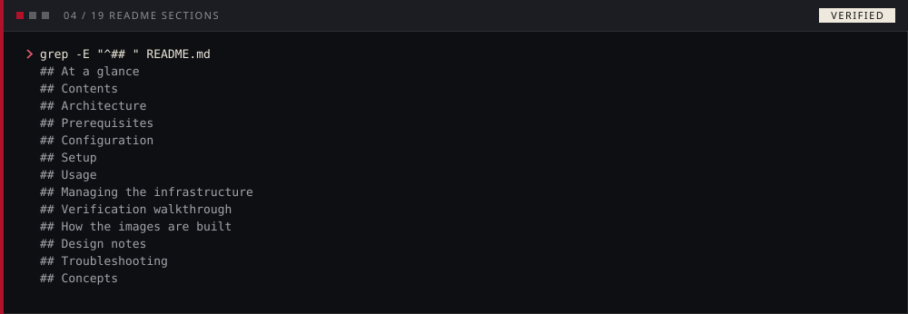

<details><summary>Transcript</summary>

```console
$ grep -E "^## " README.md
## At a glance
## Contents
## Architecture
## Prerequisites
## Configuration
## Setup
## Usage
## Managing the infrastructure
## Verification walkthrough
## How the images are built
## Design notes
## Troubleshooting
## Concepts
```

</details>

### Does the student architecture reflect the infrastructure enforced by the subject?

Six containers, one per service, on one user-defined bridge network. Only the gateway publishes a port; the two databases and the gateway logs live on named volumes.


The network, ports and volumes in this diagram are proven by the [Network](#network), [Containers](#containers) and [Volumes](#volumes) checks below.

### Does the infrastructure start correctly?

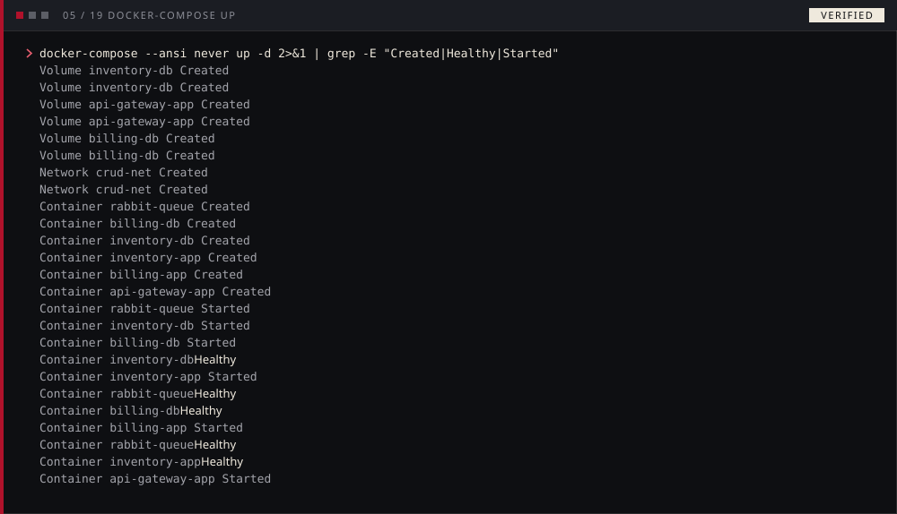

<details><summary>Transcript</summary>

```console
$ docker-compose --ansi never up -d 2>&1 | grep -E "Created|Healthy|Started"
 Volume inventory-db Created 
 Volume inventory-db Created 
 Volume api-gateway-app Created 
 Volume api-gateway-app Created 
 Volume billing-db Created 
 Volume billing-db Created 
 Network crud-net Created 
 Network crud-net Created 
 Container rabbit-queue Created 
 Container billing-db Created 
 Container inventory-db Created 
 Container inventory-app Created 
 Container billing-app Created 
 Container api-gateway-app Created 
 Container rabbit-queue Started 
 Container inventory-db Started 
 Container billing-db Started 
 Container inventory-db Healthy 
 Container inventory-app Started 
 Container rabbit-queue Healthy 
 Container billing-db Healthy 
 Container billing-app Started 
 Container rabbit-queue Healthy 
 Container inventory-app Healthy 
 Container api-gateway-app Started
```

</details>

## Dockerfiles

### Is there a Dockerfile for each service? Are all Dockerfiles based on `Debian` or `Alpine`?

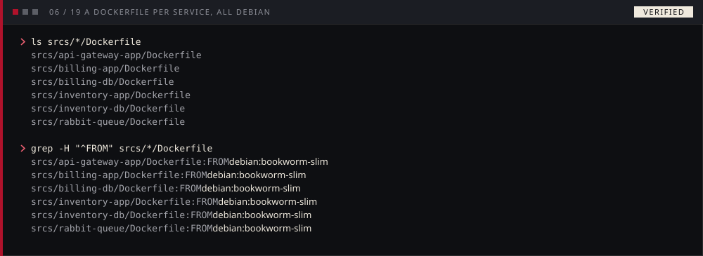

<details><summary>Transcript</summary>

```console
$ ls srcs/*/Dockerfile
srcs/api-gateway-app/Dockerfile
srcs/billing-app/Dockerfile
srcs/billing-db/Dockerfile
srcs/inventory-app/Dockerfile
srcs/inventory-db/Dockerfile
srcs/rabbit-queue/Dockerfile

$ grep -H "^FROM" srcs/*/Dockerfile
srcs/api-gateway-app/Dockerfile:FROM debian:bookworm-slim
srcs/billing-app/Dockerfile:FROM debian:bookworm-slim
srcs/billing-db/Dockerfile:FROM debian:bookworm-slim
srcs/inventory-app/Dockerfile:FROM debian:bookworm-slim
srcs/inventory-db/Dockerfile:FROM debian:bookworm-slim
srcs/rabbit-queue/Dockerfile:FROM debian:bookworm-slim
```

</details>

### Are Dockerfiles or any other solution files free from sensitive data?

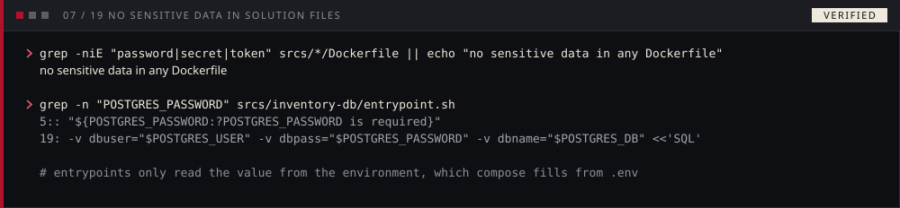

<details><summary>Transcript</summary>

```console
$ grep -niE "password|secret|token" srcs/*/Dockerfile || echo "no sensitive data in any Dockerfile"
no sensitive data in any Dockerfile

$ grep -n "POSTGRES_PASSWORD" srcs/inventory-db/entrypoint.sh
5:: "${POSTGRES_PASSWORD:?POSTGRES_PASSWORD is required}"
19:        -v dbuser="$POSTGRES_USER" -v dbpass="$POSTGRES_PASSWORD" -v dbname="$POSTGRES_DB" <<'SQL'

# entrypoints only read the value from the environment, which compose fills from .env
```

</details>

## Containers

### Do all containers have the correct configuration?

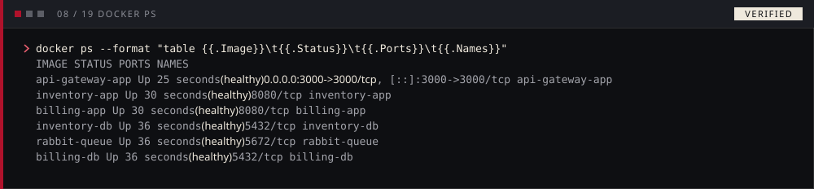

<details><summary>Transcript</summary>

```console
$ docker ps --format "table {{.Image}}\t{{.Status}}\t{{.Ports}}\t{{.Names}}"
IMAGE             STATUS                    PORTS                                         NAMES
api-gateway-app   Up 25 seconds (healthy)   0.0.0.0:3000->3000/tcp, [::]:3000->3000/tcp   api-gateway-app
inventory-app     Up 30 seconds (healthy)   8080/tcp                                      inventory-app
billing-app       Up 30 seconds (healthy)   8080/tcp                                      billing-app
inventory-db      Up 36 seconds (healthy)   5432/tcp                                      inventory-db
rabbit-queue      Up 36 seconds (healthy)   5672/tcp                                      rabbit-queue
billing-db        Up 36 seconds (healthy)   5432/tcp                                      billing-db
```

</details>

### Are the containers configured to restart in case of failure?

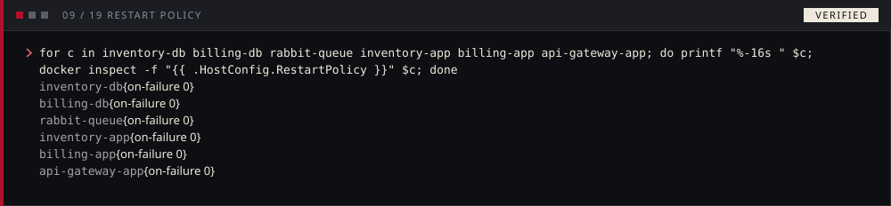

<details><summary>Transcript</summary>

```console
$ for c in inventory-db billing-db rabbit-queue inventory-app billing-app api-gateway-app; do printf "%-16s " $c; docker inspect -f "{{ .HostConfig.RestartPolicy }}" $c; done
inventory-db     {on-failure 0}
billing-db       {on-failure 0}
rabbit-queue     {on-failure 0}
inventory-app    {on-failure 0}
billing-app      {on-failure 0}
api-gateway-app  {on-failure 0}
```

</details>

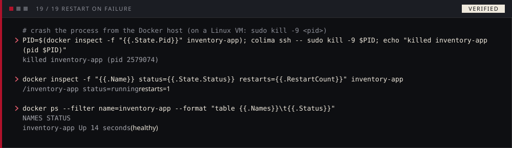

<details><summary>Transcript</summary>

```console
# crash the process from the Docker host (on a Linux VM: sudo kill -9 <pid>)
$ PID=$(docker inspect -f "{{.State.Pid}}" inventory-app); colima ssh -- sudo kill -9 $PID; echo "killed inventory-app (pid $PID)"
killed inventory-app (pid 2579074)

$ docker inspect -f "{{.Name}}  status={{.State.Status}}  restarts={{.RestartCount}}" inventory-app
/inventory-app  status=running  restarts=1

$ docker ps --filter name=inventory-app --format "table {{.Names}}\t{{.Status}}"
NAMES           STATUS
inventory-app   Up 14 seconds (healthy)
```

</details>

## Volumes

### Do all volumes have the correct configuration?

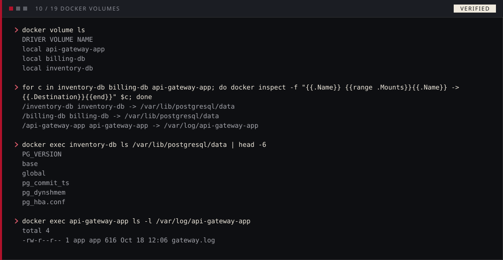

<details><summary>Transcript</summary>

```console
$ docker volume ls
DRIVER    VOLUME NAME
local     api-gateway-app
local     billing-db
local     inventory-db

$ for c in inventory-db billing-db api-gateway-app; do docker inspect -f "{{.Name}}  {{range .Mounts}}{{.Name}} -> {{.Destination}}{{end}}" $c; done
/inventory-db  inventory-db -> /var/lib/postgresql/data
/billing-db  billing-db -> /var/lib/postgresql/data
/api-gateway-app  api-gateway-app -> /var/log/api-gateway-app

$ docker exec inventory-db ls /var/lib/postgresql/data | head -6
PG_VERSION
base
global
pg_commit_ts
pg_dynshmem
pg_hba.conf

$ docker exec api-gateway-app ls -l /var/log/api-gateway-app
total 4
-rw-r--r-- 1 app app 616 Oct 18 12:06 gateway.log
```

</details>

## Network

### Is the connection to the api-gateway-app the only one exposed from outside of the Docker host?

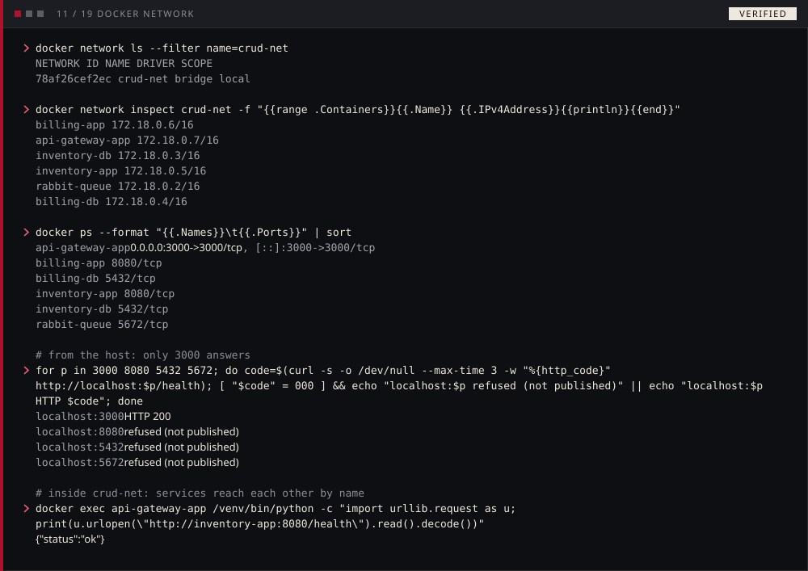

<details><summary>Transcript</summary>

```console
$ docker network ls --filter name=crud-net
NETWORK ID     NAME       DRIVER    SCOPE
78af26cef2ec   crud-net   bridge    local

$ docker network inspect crud-net -f "{{range .Containers}}{{.Name}}  {{.IPv4Address}}{{println}}{{end}}"
billing-app  172.18.0.6/16
api-gateway-app  172.18.0.7/16
inventory-db  172.18.0.3/16
inventory-app  172.18.0.5/16
rabbit-queue  172.18.0.2/16
billing-db  172.18.0.4/16


$ docker ps --format "{{.Names}}\t{{.Ports}}" | sort
api-gateway-app	0.0.0.0:3000->3000/tcp, [::]:3000->3000/tcp
billing-app	8080/tcp
billing-db	5432/tcp
inventory-app	8080/tcp
inventory-db	5432/tcp
rabbit-queue	5672/tcp

# from the host: only 3000 answers
$ for p in 3000 8080 5432 5672; do code=$(curl -s -o /dev/null --max-time 3 -w "%{http_code}" http://localhost:$p/health); [ "$code" = 000 ] && echo "localhost:$p  refused (not published)" || echo "localhost:$p  HTTP $code"; done
localhost:3000  HTTP 200
localhost:8080  refused (not published)
localhost:5432  refused (not published)
localhost:5672  refused (not published)

# inside crud-net: services reach each other by name
$ docker exec api-gateway-app /venv/bin/python -c "import urllib.request as u; print(u.urlopen(\"http://inventory-app:8080/health\").read().decode())"
{"status":"ok"}
```

</details>

## Images

### Is there a Docker image for each service with the same service name?

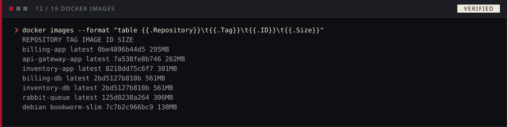

<details><summary>Transcript</summary>

```console
$ docker images --format "table {{.Repository}}\t{{.Tag}}\t{{.ID}}\t{{.Size}}"
REPOSITORY        TAG             IMAGE ID       SIZE
billing-app       latest          0be4896b44d5   295MB
api-gateway-app   latest          7a538fe8b746   262MB
inventory-app     latest          8210dd75c6f7   301MB
billing-db        latest          2bd5127b810b   561MB
inventory-db      latest          2bd5127b810b   561MB
rabbit-queue      latest          125d0238a264   306MB
debian            bookworm-slim   7c7b2c966bc9   138MB
```

</details>

## Inventory API

### `POST /api/movies/` — was the response the success code `200`?

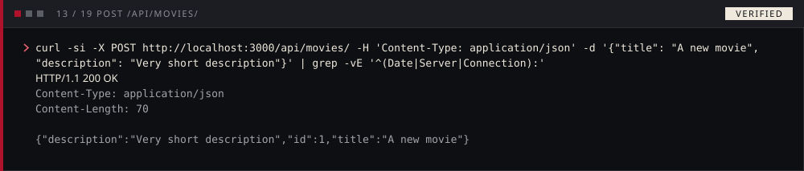

<details><summary>Transcript</summary>

```console
$ curl -si -X POST http://localhost:3000/api/movies/ -H 'Content-Type: application/json' -d '{"title": "A new movie", "description": "Very short description"}' | grep -vE '^(Date|Server|Connection):'
HTTP/1.1 200 OK
Content-Type: application/json
Content-Length: 70

{"description":"Very short description","id":1,"title":"A new movie"}
```

</details>

### `GET /api/movies/` — was the response `200`, in JSON, with the last added movie?

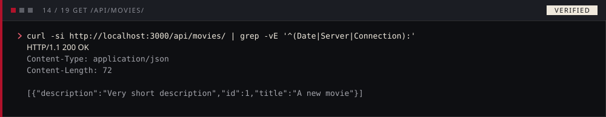

<details><summary>Transcript</summary>

```console
$ curl -si http://localhost:3000/api/movies/ | grep -vE '^(Date|Server|Connection):'
HTTP/1.1 200 OK
Content-Type: application/json
Content-Length: 72

[{"description":"Very short description","id":1,"title":"A new movie"}]
```

</details>

## Billing API

### `POST /api/billing/` — was the response the success code `200`?

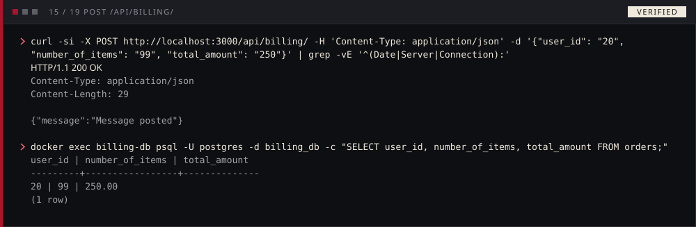

<details><summary>Transcript</summary>

```console
$ curl -si -X POST http://localhost:3000/api/billing/ -H 'Content-Type: application/json' -d '{"user_id": "20", "number_of_items": "99", "total_amount": "250"}' | grep -vE '^(Date|Server|Connection):'
HTTP/1.1 200 OK
Content-Type: application/json
Content-Length: 29

{"message":"Message posted"}

$ docker exec billing-db psql -U postgres -d billing_db -c "SELECT user_id, number_of_items, total_amount FROM orders;"
 user_id | number_of_items | total_amount 
---------+-----------------+--------------
 20      |              99 |       250.00
(1 row)
```

</details>

### Was the `billing-app` container correctly stopped?

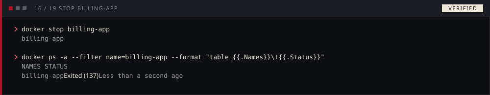

<details><summary>Transcript</summary>

```console
$ docker stop billing-app
billing-app

$ docker ps -a --filter name=billing-app --format "table {{.Names}}\t{{.Status}}"
NAMES         STATUS
billing-app   Exited (137) Less than a second ago
```

</details>

### `POST /api/billing/` with `billing-app` stopped — still `200`?

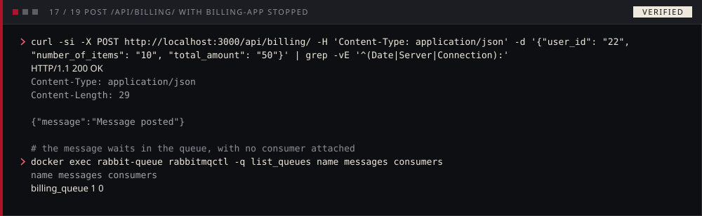

<details><summary>Transcript</summary>

```console
$ curl -si -X POST http://localhost:3000/api/billing/ -H 'Content-Type: application/json' -d '{"user_id": "22", "number_of_items": "10", "total_amount": "50"}' | grep -vE '^(Date|Server|Connection):'
HTTP/1.1 200 OK
Content-Type: application/json
Content-Length: 29

{"message":"Message posted"}

# the message waits in the queue, with no consumer attached
$ docker exec rabbit-queue rabbitmqctl -q list_queues name messages consumers
name	messages	consumers
billing_queue	1	0
```

</details>

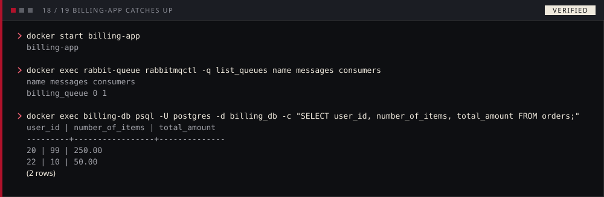

<details><summary>Transcript</summary>

```console
$ docker start billing-app
billing-app

$ docker exec rabbit-queue rabbitmqctl -q list_queues name messages consumers
name	messages	consumers
billing_queue	0	1

$ docker exec billing-db psql -U postgres -d billing_db -c "SELECT user_id, number_of_items, total_amount FROM orders;"
 user_id | number_of_items | total_amount 
---------+-----------------+--------------
 20      |              99 |       250.00
 22      |              10 |        50.00
(2 rows)
```

</details>

## Reproducing this on the audit machine

Everything above uses only `docker`, `docker-compose` and `curl`, so each command can be pasted as-is on a Linux VM. One difference: the crash in check 19 was triggered with `colima ssh -- sudo kill -9 <pid>` because Docker runs inside a VM on macOS. On a Linux host run the kill directly:

```bash
sudo kill -9 $(docker inspect -f '{{.State.Pid}}' inventory-app)
```

`docker stop` and `docker kill` don't count as failures; Docker treats them as a deliberate stop and leaves the container down.
