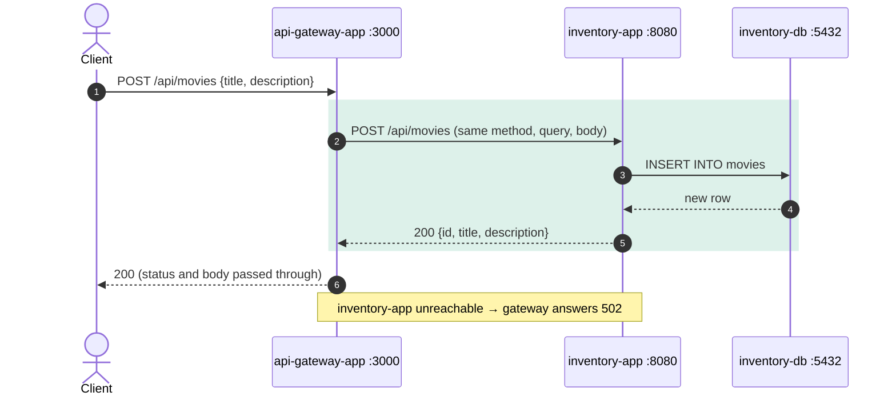
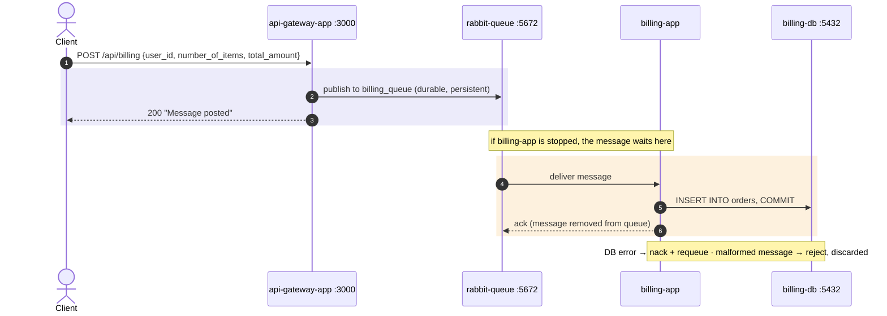
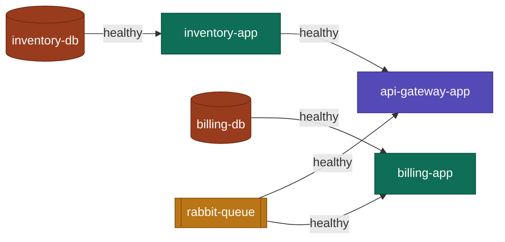

<div align="center">

# 🐳 play-with-containers

**The `crud-master` movie-streaming microservices, fully containerized.**

Six images built from source · one private network · three named volumes · managed by `docker compose` alone


</div>

---

## At a glance

| | | |
|:-:|:-:|:-:|
| 📦 **6 containers**<br/>one per service, each with its own `Dockerfile` | 🌐 **1 network**<br/>`crud-net`, only port `3000` published | 💾 **3 volumes**<br/>two databases + gateway logs |
| 🧱 **1 base image**<br/>`debian:bookworm-slim`, nothing else pulled | ♻️ **Self-healing**<br/>`restart: on-failure` + healthchecks | 🔐 **No secrets in git**<br/>credentials live in an ignored `.env` |

## Contents

| | Section | What you'll find |
|:-:|---|---|
| 🏗️ | [Architecture](#architecture) | Diagrams of the containers, both request flows and startup order |
| ✅ | [Prerequisites](#prerequisites) | What must be installed |
| ⚙️ | [Configuration](#configuration) | The `.env` variables |
| 🚀 | [Setup](#setup) | Clone, configure, start |
| 🎬 | [Usage](#usage) | API reference and `curl` examples |
| 🧰 | [Managing the infrastructure](#managing-the-infrastructure) | Day-to-day Compose commands |
| 🔎 | [Verification walkthrough](#verification-walkthrough) | Seven checks that prove each requirement |
| 🧾 | [Audit evidence](AUDIT.md) | Every audit-sheet check, recorded from a clean run with screenshots |
| 🧱 | [How the images are built](#how-the-images-are-built) | Base image, layers, users, entrypoints |
| 📝 | [Design notes](#design-notes) | Why things are the way they are |
| 🩺 | [Troubleshooting](#troubleshooting) | Symptoms and fixes |
| 📚 | [Concepts](#concepts) | Short answers to the audit's theory questions |

## Architecture



Solid wires are request and response (the movies flow, steps 1–2); dashed wires are messages (the billing flow, steps A–D). The carmine wire is the only way in from outside the Docker host.

`billing-app` opens the connection to `rabbit-queue`, and the broker pushes messages down it
(step B); nothing ever calls `billing-app` over HTTP.

### Flow 1 — movies (synchronous)



### Flow 2 — billing (asynchronous)



### Startup order



Compose starts the three backing services first, waits for each healthcheck to pass, then
starts the apps that depend on them; `docker compose down` stops them in the reverse order.

| Service           | Image contents                     | Port (internal) | Volume                                        |
|-------------------|------------------------------------|-----------------|-----------------------------------------------|
| 🟥 `inventory-db`    | PostgreSQL 15                      | 5432            | `inventory-db` → `/var/lib/postgresql/data`   |
| 🟥 `billing-db`      | PostgreSQL 15                      | 5432            | `billing-db` → `/var/lib/postgresql/data`     |
| 🟧 `rabbit-queue`    | RabbitMQ server                    | 5672            | —                                             |
| 🟩 `inventory-app`   | Python 3 + Flask CRUD API          | 8080            | —                                             |
| 🟩 `billing-app`     | Python 3 + pika queue consumer     | 8080            | —                                             |
| 🟪 `api-gateway-app` | Python 3 + Flask gateway           | 3000 → host     | `api-gateway-app` → `/var/log/api-gateway-app`|

Request flow:

- **Movies** — `api-gateway-app` proxies `/api/movies` over HTTP to `inventory-app`, which reads
  and writes the `movies` table in `inventory-db`.
- **Billing** — `api-gateway-app` publishes the JSON body of `POST /api/billing` to a durable
  queue on `rabbit-queue` and answers immediately. `billing-app` consumes the queue and inserts
  each message into the `orders` table in `billing-db`. If `billing-app` is down, messages wait
  in the queue and are processed when it comes back.

### Repository layout

```
.
├── docker-compose.yml      # all six services, the network and the volumes
├── .env.example            # template for the credentials file
├── README.md
└── srcs
    ├── api-gateway-app/    # Dockerfile, server.py, app/ (routes, RabbitMQ publisher)
    ├── billing-app/        # Dockerfile, server.py, health.py, app/ (consumer, DB model)
    ├── billing-db/         # Dockerfile, entrypoint.sh
    ├── inventory-app/      # Dockerfile, server.py, app/ (routes, model)
    ├── inventory-db/       # Dockerfile, entrypoint.sh
    └── rabbit-queue/       # Dockerfile, entrypoint.sh
```

## Prerequisites

- Linux host or VM with Docker Engine
- Docker Compose — either the `docker compose` plugin (v2) or standalone `docker-compose` ≥ 1.29.
  Commands below use `docker compose`; substitute `docker-compose` if that is what you have.
- Port `3000` free on the host
- Internet access for the first build (Debian packages and PyPI)

Check:

```bash
docker --version
docker compose version
```

## Configuration

Every credential comes from a `.env` file next to `docker-compose.yml`. Compose reads it
automatically and substitutes the values into the service definitions. The file is listed in
`.gitignore` and must never be committed; `.env.example` is the committed template.

| Variable                 | Used by                          | Meaning                               |
|--------------------------|----------------------------------|---------------------------------------|
| `INVENTORY_DB_USER`      | `inventory-db`, `inventory-app`  | PostgreSQL role for the inventory DB  |
| `INVENTORY_DB_PASSWORD`  | `inventory-db`, `inventory-app`  | Its password                          |
| `INVENTORY_DB_NAME`      | `inventory-db`, `inventory-app`  | Database name (e.g. `movies_db`)      |
| `BILLING_DB_USER`        | `billing-db`, `billing-app`      | PostgreSQL role for the billing DB    |
| `BILLING_DB_PASSWORD`    | `billing-db`, `billing-app`      | Its password                          |
| `BILLING_DB_NAME`        | `billing-db`, `billing-app`      | Database name (e.g. `billing_db`)     |
| `RABBITMQ_USER`          | `rabbit-queue`, gateway, billing | RabbitMQ user                         |
| `RABBITMQ_PASSWORD`      | `rabbit-queue`, gateway, billing | Its password                          |
| `BILLING_QUEUE`          | gateway, `billing-app`           | Queue name (e.g. `billing_queue`)     |

> [!WARNING]
> Never commit `.env`. It is already in `.gitignore`; only `.env.example` belongs in the repository.

> [!NOTE]
> Database users and databases are created the first time a database container starts on an
> empty volume. Changing a DB credential afterwards has no effect on an existing volume — see
> [Troubleshooting](#troubleshooting).

## Setup

```bash
git clone <this-repo> play-with-containers
cd play-with-containers
cp .env.example .env
```

Edit `.env` and replace every `change-me`, then build and start:

```bash
docker compose up -d --build
```

> [!TIP]
> The first build takes a few minutes. Wait until every service reports `healthy`:

```bash
docker compose ps
```

## Usage

The API is at `http://localhost:3000`. Paths work with or without a trailing slash.

| Method   | Path                    | Body                                            | Result                                |
|----------|-------------------------|-------------------------------------------------|---------------------------------------|
| `GET`    | `/api/movies`           | —                                               | all movies; `?title=` filters by name |
| `POST`   | `/api/movies`           | `{"title": "...", "description": "..."}`        | `200` with the created movie          |
| `DELETE` | `/api/movies`           | —                                               | deletes all movies                    |
| `GET`    | `/api/movies/<id>`      | —                                               | one movie, or `404`                   |
| `PUT`    | `/api/movies/<id>`      | `{"title": "...", "description": "..."}`        | the updated movie                     |
| `DELETE` | `/api/movies/<id>`      | —                                               | deletes one movie                     |
| `POST`   | `/api/billing`          | `{"user_id", "number_of_items", "total_amount"}`| `200` — queued for `billing-app`      |
| `GET`    | `/health`               | —                                               | gateway liveness                      |

| Status | Meaning |
|:-:|---|
| 🟢 `200` | Success — for `POST /api/billing` it means the message was accepted and queued |
| 🟡 `400` / `404` | Bad body / movie not found |
| 🔴 `502` | `inventory-app` or `rabbit-queue` cannot be reached |

```bash
curl -X POST http://localhost:3000/api/movies/ \
  -H "Content-Type: application/json" \
  -d '{"title": "A new movie", "description": "Very short description"}'
```

```bash
curl http://localhost:3000/api/movies/
```

```bash
curl -X POST http://localhost:3000/api/billing/ \
  -H "Content-Type: application/json" \
  -d '{"user_id": "20", "number_of_items": "99", "total_amount": "250"}'
```

## Managing the infrastructure

| Task                                   | Command                                             |
|----------------------------------------|-----------------------------------------------------|
| Build images                           | `docker compose build`                              |
| Create and start everything            | `docker compose up -d`                              |
| Status and health                      | `docker compose ps`                                 |
| Follow logs (all / one service)        | `docker compose logs -f [service]`                  |
| Stop / start one service               | `docker compose stop billing-app` / `start`         |
| Rebuild one service after a code edit  | `docker compose up -d --build inventory-app`        |
| Stop and remove containers + network   | `docker compose down`                               |
| ⚠️ …and also delete the volumes (data) | `docker compose down -v`                            |
| ⚠️ …and also delete the built images   | `docker compose down -v --rmi all`                  |

Useful inspection commands:

```bash
docker exec -it inventory-db psql -U postgres -d movies_db -c 'TABLE movies;'
docker exec -it billing-db   psql -U postgres -d billing_db -c 'TABLE orders;'
docker exec -it rabbit-queue rabbitmqctl list_queues name messages consumers
docker exec -it api-gateway-app cat /var/log/api-gateway-app/gateway.log
```

(Replace `movies_db` / `billing_db` with the names from your `.env`. Inside the database
containers, the `postgres` superuser connects over the local socket without a password.)

## Verification walkthrough

Run these after `docker compose up -d --build` to check each requirement of the subject.
A recorded run of every audit-sheet check, with screenshots, is in [AUDIT.md](AUDIT.md).

#### 📦 Step 1 — Six containers, all up, only the gateway published

```bash
docker ps -a --format 'table {{.Names}}\t{{.Image}}\t{{.Status}}\t{{.Ports}}'
```

Expect six rows whose name and image are identical, status `Up … (healthy)`, and
`0.0.0.0:3000->3000/tcp` on `api-gateway-app` only.

#### 🖼️ Step 2 — Images, volumes, network

```bash
docker images
docker volume ls
docker network ls
docker network inspect crud-net --format '{{range .Containers}}{{.Name}} {{end}}'
```

Expect six images named after the services plus `debian:bookworm-slim`; volumes
`inventory-db`, `billing-db`, `api-gateway-app`; network `crud-net` containing all six containers.

#### 🎬 Step 3 — Movies round trip

Run the `POST` and `GET` from [Usage](#usage); the movie comes back.

#### 📨 Step 4 — Billing while the consumer is down

```bash
docker compose stop billing-app
curl -X POST http://localhost:3000/api/billing/ -H "Content-Type: application/json" \
  -d '{"user_id": "22", "number_of_items": "10", "total_amount": "50"}'
docker exec rabbit-queue rabbitmqctl list_queues name messages
docker compose start billing-app
docker exec billing-db psql -U postgres -d billing_db -c 'TABLE orders;'
```

The `POST` still returns `200`, the queue shows 1 waiting message, and after the restart the
order for user `22` is in the table.

#### ♻️ Step 5 — Restart on failure

```bash
sudo kill -9 $(docker inspect -f '{{.State.Pid}}' inventory-app)
sleep 15
docker ps --filter name=inventory-app
docker inspect -f 'restarts={{.RestartCount}}' inventory-app
```

The container is back with a fresh `Up` time and `restarts=1`. The same works for any of the
six services; killing a database or the queue also makes the apps that depend on it exit and
come back on their own.

> [!NOTE]
> The crash has to come from the host. `docker exec <name> kill 1` does nothing, because the
> kernel protects a container's PID 1 from signals sent inside its own namespace, and
> `docker stop` / `docker kill` count as a deliberate stop that the restart policy respects.
> On Docker Desktop or Colima, run the `kill` inside the VM (e.g. `colima ssh -- sudo kill -9 <pid>`).

#### 💾 Step 6 — Data survives container removal

```bash
docker compose down
docker compose up -d
curl http://localhost:3000/api/movies/
```

The movies created earlier are still there (the volumes were kept).

#### 🔒 Step 7 — Not reachable from outside

```bash
curl --max-time 3 http://localhost:8080/api/movies
```

Fails: only port 3000 is published.

## How the images are built

- **Base image** — every Dockerfile starts `FROM debian:bookworm-slim`. Debian 12 "bookworm" is
  the penultimate stable release (Debian 13 "trixie" is the current one). The tag is pinned;
  `latest` is never used. No other image is pulled: PostgreSQL and RabbitMQ are installed with
  `apt-get` instead of using the official `postgres` / `rabbitmq` images.
- **Layers** — each `RUN` that installs packages also cleans the apt lists in the same
  instruction, so the cache never lands in a layer. The first `RUN` of the three app images is
  byte-identical, so Docker builds that layer once and all three images share it. In the app
  images `requirements.txt` is copied and installed before the source code, so editing code
  does not invalidate the dependency layer. A `.dockerignore` keeps `__pycache__`, `.env` and
  the Dockerfile itself out of the build context.
- **Users** — the app containers run as an unprivileged `app` user. PostgreSQL runs as
  `postgres` (the entrypoint drops privileges with `gosu`).
- **Entrypoints** — the database entrypoint initializes a cluster, role and database only when
  the data directory is empty, then `exec`s the server so it is PID 1 and receives Docker's
  stop signal directly. The RabbitMQ entrypoint creates the configured user on first boot and
  is safe to re-run on every restart.

## Design notes

- **Naming** — `image:`, `container_name:`, volume `name:` and network `name:` are all set
  explicitly, so `docker images`, `docker ps`, `docker volume ls` and `docker network ls` show
  the plain names (`inventory-db`, …) instead of Compose's `<project>_` prefixed defaults.
- **Isolation** — only `api-gateway-app` has a `ports:` mapping. The other services use
  `expose:`, which documents the port but publishes nothing; they are reachable only by service
  name over `crud-net`, using Docker's built-in DNS.
- **Restart policy** — `restart: on-failure` on every service: Docker restarts a container
  whenever its main process exits with an error, and leaves it alone after a manual
  `docker stop` (needed for walkthrough step 4). Check it with
  `docker inspect -f "{{ .HostConfig.RestartPolicy }}" <container>` → `{on-failure 0}`.
- **Startup order** — each service has a healthcheck (`pg_isready`,
  `rabbitmq-diagnostics check_port_connectivity`, HTTP `/health`), and `depends_on` uses
  `condition: service_healthy`, so an app starts only when its database or queue accepts
  connections.
- **`billing-app` on 8080** — the service's real work is consuming the queue and has no HTTP
  API. A small standard-library HTTP server answers on 8080 so the container is reachable on
  the port the subject asks for and can be health-checked.
- **Durable messaging** — the queue is declared durable, messages are published persistent,
  and `billing-app` acknowledges only after the database commit. A message that fails on a
  database error is requeued; a malformed message is logged and discarded rather than looping
  forever.
- **Gateway logs** — the gateway writes its own and werkzeug's access logs to a rotating file
  in `/var/log/api-gateway-app`, which is the `api-gateway-app` volume.
- **No RabbitMQ volume** — the subject defines exactly three volumes. Queued messages survive
  a restart or stop/start of `rabbit-queue`, but not `docker compose down`, which removes the
  container.

## Troubleshooting

| Symptom | Cause and fix |
|---------|---------------|
| `variable is not set` warnings, DB containers exit immediately | `.env` is missing or incomplete. `cp .env.example .env` and fill it in. |
| App logs show `password authentication failed` after editing `.env` | The database volume was initialized with the old credentials. `docker compose down -v` and start again (this deletes the data). |
| DB logs `database files are incompatible with server`, or the gateway logs `Permission denied` on `gateway.log` | Volumes left over from an older build of this project (PostgreSQL 13, root-owned log directory). `docker compose down -v` and start again. |
| `port is already allocated` | Something else is using host port 3000. Stop it, or change the left side of `"3000:3000"`. |
| A service stays `starting` or `unhealthy` | `docker compose logs <service>`; RabbitMQ can take ~30 s on first boot. |
| `curl` to the gateway returns `502` | `inventory-app` or `rabbit-queue` is down: `docker compose ps`. |
| `COPY`/`RUN` step reuses stale code | `docker compose build --no-cache <service>`. |

## Concepts

Short answers to the questions this project is meant to teach.

- **Container** — a process (or group of processes) isolated by the Linux kernel with namespaces
  and limited with cgroups, started from an image that packages the code and its dependencies.
  It starts in milliseconds, is reproducible across machines, and uses little overhead.
- **Container vs virtual machine** — a VM virtualizes hardware and boots its own kernel and full
  OS; a container shares the host kernel and virtualizes only the user space. Containers are
  lighter and faster; VMs isolate more strongly and can run a different OS.
- **Docker** — a platform for building, shipping and running containers: a daemon (`dockerd`),
  a CLI, an image format and registries.
- **Dockerfile** — the recipe for an image. Each instruction (`FROM`, `RUN`, `COPY`, …) produces
  a layer; layers are cached and shared between images, which is why instruction order and
  merging related commands into one `RUN` matter.
- **Image** — a read-only stack of layers plus metadata (entrypoint, env, exposed ports). A
  container is a running instance of an image with a thin writable layer on top.
- **Volume** — storage managed by Docker that lives outside the container's writable layer, so
  data survives the container being removed and recreated. Used here for both databases and
  the gateway logs.
- **Network** — a user-defined bridge network gives containers a private subnet and DNS by
  container/service name. Containers on it can talk to each other; nothing is reachable from
  the host unless a port is published.
- **Dockerfile instructions used here** — `FROM` picks the base image; `RUN` executes a command
  at build time and saves the result as a layer; `COPY` adds files from the build context;
  `WORKDIR` sets the working directory; `ENV` sets environment variables; `USER` switches the
  user the process runs as; `EXPOSE` documents the listening port (it publishes nothing);
  `VOLUME` marks a path as persistent data; `STOPSIGNAL` chooses the signal `docker stop` sends;
  `ENTRYPOINT` is the process started as PID 1 when the container runs.
- **Microservices architecture** — an application split into small services that each own one
  business capability and its own data (inventory, billing), run as separate processes and
  talk over the network (HTTP, messages) instead of function calls.
- **Why microservices** — each service can be developed, deployed, scaled and restarted
  independently, a failure stays contained (billing can be down while movies still work), and
  each can use the technology that suits it. The cost is more operational complexity.
- **Queue** — a buffer that holds messages from a producer until a consumer is ready. It
  decouples the two in time: the producer does not wait, and nothing is lost if the consumer
  is down. Here the gateway produces billing messages and `billing-app` consumes them.
- **RabbitMQ** — an open-source message broker implementing AMQP. Producers publish messages
  to it, it stores them in queues (durable ones survive a broker restart), delivers them to
  consumers, and removes each message once the consumer acknowledges it.
- **Docker Compose** — a tool that describes a multi-container application (services, networks,
  volumes) in one YAML file and manages its whole lifecycle with single commands.
- **`.env`** — keeps secrets out of the repository and out of the images; Compose injects them
  as environment variables at run time.
